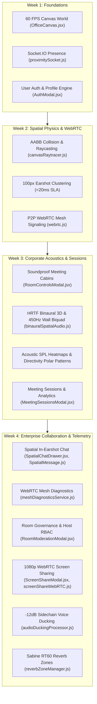

# 🌐 ProxiSpeak — Virtual Corporate Office Geospatial Audio Ecosystem

An enterprise-grade, browser-based 2D virtual office platform featuring 60 FPS HTML5 canvas physics, real-time WebRTC audio mesh, Sabine acoustic reverb zones, directional polar directivity, and geospatial proximity isolation.

---

## 👥 Engineering Roles & Responsibilities

| Role | Engineer | Email | Primary Branches | Core Scope |
| :--- | :--- | :--- | :--- | :--- |
| **Backend Architect & Systems Lead** | **Koneti Manikanth** | `manikanth9878@gmail.com` | `manikanth` | Node.js/Express, Socket.IO, MongoDB, spatial chat, mesh telemetry, host moderation RBAC |
| **Frontend UI/UX & React Engineer** | **Harshitha Rao** | `harshithar978@gmail.com` | `harshitha` / `harshita` | React 19, modal dialogs, spatial chat drawer, presentation mode, responsive design system |
| **Canvas Spatial DSP & Audio Engineer** | **Leela Sai Likhitha Yekollu** | `sailikhitha.yekollu@gmail.com` | `likhitha` / `likhita` | 60 FPS HTML5 Canvas engine, Web Audio API, HRTF binaural panning, sidechain ducking, Sabine RT60 reverb |

---

## 📅 4-Week Comprehensive Engineering Roadmap



---

## 🛠️ Weekly Deliverables by Role

### 1. Week 1 — Core Infrastructure
- **Koneti Manikanth (Backend)**: Express + Socket.IO server, Floor 4 seed data (`officeLayout`), real-time `office:users` state synchronization, MongoDB Schemas (`User`, `OfficeLayout`, `AudioBeacon`).
- **Harshitha Rao (Frontend)**: React 19 corporate layout, `Navbar.jsx`, `AuthModal.jsx`, `Sidebar.jsx`, CSS design system.
- **Leela Sai Likhitha Yekollu (Canvas DSP)**: HTML5 2D Canvas viewport (1000x750 normalized), WASD/Arrow keyboard loop, avatar drawing, proximity radius rings.

### 2. Week 2 — Spatial Collision & Audio Mesh
- **Koneti Manikanth (Backend)**: `<20ms` proximity clustering engine, WebRTC signaling relay (`webrtc:offer`, `webrtc:answer`, `webrtc:ice-candidate`), beacon geospatial REST endpoints.
- **Harshitha Rao (Frontend)**: `CoworkersPanel.jsx` with radar view, live status pills, broadcast creation modal, interactive controls.
- **Leela Sai Likhitha Yekollu (Canvas DSP)**: AABB collision detection, doorway pass-throughs, `canvasRaytracer.js` for acoustic line-of-sight, `canvasVoiceWaves.js` for dynamic mic visualizers.

### 3. Week 3 — Corporate Acoustics & Soundproofing
- **Koneti Manikanth (Backend)**: `roomRecordingService.js`, `audioMetricsService.js`, `spatialAudioMixerService.js`, `spatialOcclusionService.js`, confidential room audio boundaries.
- **Harshitha Rao (Frontend)**: `RoomControlsModal.jsx`, `AcousticEqualizerModal.jsx`, `AcousticMixerModal.jsx`, `AcousticAnalyticsModal.jsx`, `AudioHealthModal.jsx`, `MeetingSessionsModal.jsx`.
- **Leela Sai Likhitha Yekollu (Canvas DSP)**: `binauralSpatialAudio.js` (HRTF spatial panning), `acousticReverbEngine.js` (Sabine impulse convolution), `acousticHeatmap.js` (decibel isolines), `directionalMicrophone.js` (cardioid/hypercardioid polar patterns).

### 4. Week 4 — Collaboration, Telemetry & Host Governance
- **Koneti Manikanth (Backend)**:
  - `SpatialMessage.js`: Proximity text schema with 600-second TTL indexing and geospatial coordinate encapsulation.
  - `spatialChatService.js`: Acoustic boundary message filtering preventing cross-room leakage.
  - `meshDiagnosticsService.js`: Real-time RTT latency, jitter, packet loss, and SLA health monitoring.
  - `roomModerationService.js`: Host RBAC, Soundproof privacy lock, Mute-All, and participant ejection.
  - Test suites: `week4_spatial_chat.test.mjs`, `week4_mesh_diagnostics.test.mjs`, `week4_room_moderation.test.mjs`.
- **Harshitha Rao (Frontend)**:
  - `SpatialChatDrawer.jsx`: Proximity text drawer with earshot distance indicators and confidential room locks.
  - `ScreenShareModal.jsx`: 1080p WebRTC presentation viewport with full-screen, attendee roster, and audio pass-through.
  - `RoomModerationModal.jsx`: Governance modal with host controls (Mute All, Kick, Soundproof Lock, Audit Logs).
  - Integration into `Navbar.jsx` and `App.jsx`.
- **Leela Sai Likhitha Yekollu (Canvas DSP)**:
  - `audioDuckingProcessor.js`: -12 dB sidechain voice ducking with smooth exponential gain ramps.
  - `screenShareWebRTC.js`: Multi-track WebRTC display media capture manager with adaptive bitrate throttling (500 kbps – 4000 kbps).
  - `reverbZoneManager.js`: Zone-based acoustic reverb with procedural Sabine impulse response generation (RT60: 0.25s to 2.8s).

---

## 🚀 Running the Project

### Prerequisites
- Node.js >= 18
- MongoDB running on `localhost:27017`

### 1. Backend Server Setup
```bash
cd server
npm install
npm run dev
# Server listening on http://localhost:5000
```

### 2. Frontend Client Setup
```bash
cd client
npm install
npm run dev
# Vite client running on http://localhost:5173
```

### 3. Verification & Test Suites
```bash
# Backend test suites
node server/tests/week4_spatial_chat.test.mjs
node server/tests/week4_room_moderation.test.mjs
node server/tests/week4_mesh_diagnostics.test.mjs

# Frontend production build
npm --prefix client run build
```
