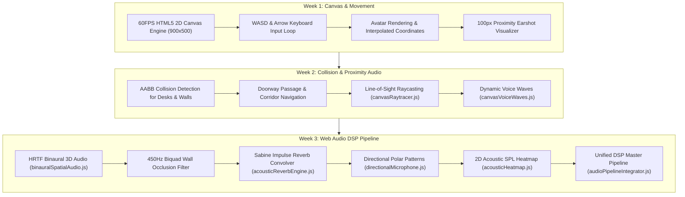

# ProxiSpeak — Canvas Spatial DSP & Audio Engine

**Branch**: `likhitha` (mirrored on `likhita`)  
**Author**: Likhitha (`sailikhitha.yekollu@gmail.com` / `Leela sai likhitha yekollu`)  
**Role**: Canvas Spatial DSP & Audio Engineer  
**Scope**: 3-Week Comprehensive Deliverables (Weeks 1 to 3)

---

## 🎧 3-Week Engineering Milestones & Deliverables



---

## 📅 Detailed 3-Week Progression

### 🔹 Week 1: Real-Time Multiplayer Canvas & Keyboard Navigation
* **60FPS HTML5 Canvas Viewport**:
  - Implemented the interactive 900x500 virtual office workspace rendering loop.
  - Rendered customized avatar circles with facing indicators, status tags, and smooth coordinate interpolation between Socket.IO updates.
* **Responsive Keyboard Movement Loop**:
  - Implemented WASD and arrow key event listeners with non-blocking key-repeat loops.
  - Added boundary constraints keeping avatars strictly within the office perimeter.
* **100px Earshot Proximity Indicator**:
  - Rendered visual proximity circles around avatars in real-time.
  - When colleagues approach within the 100px radius, visual linking paths and distance indicators activate.

### 🔹 Week 2: AABB Obstacle Collision, Raytracing & Voice Waves
* **Axis-Aligned Bounding Box (AABB) Collision System**:
  - Built physical obstacle geometry for 8 workstation clusters, conference tables, and room partitions.
  - Designed collision boundaries that block wall pass-through while allowing seamless entry through designated doorways.
* **Line-of-Sight 2D Raycasting (`canvasRaytracer.js`)**:
  - Implemented raycasting algorithm casting rays between listener and speaker coordinates to detect partition intersections.
  - Enables real-time wall detection before applying acoustic filtering.
* **Dynamic Acoustic Proximity Attenuation**:
  - Implemented linear volume dropoff formula:
    $$\text{Gain} = \max\left(0, 1 - \frac{\text{distance}}{100}\right)$$
* **Animated Voice Wave Radiance (`canvasVoiceWaves.js`)**:
  - Added dynamic concentric wave animations emanating from actively speaking avatars based on real-time microphone RMS input.

### 🔹 Week 3: Web Audio API HRTF 3D Spatialization, Convolver Reverb & DSP Integrator
* **Binaural HRTF 3D Spatial Audio (`binauralSpatialAudio.js`)**:
  - Leveraged Web Audio API `AudioListener` and `PannerNode` with HRTF panning model.
  - Computed interaural time differences (ITD) and interaural level differences (ILD) relative to avatar facing orientation angle.
* **Acoustic Wall Occlusion Filter**:
  - Implemented dynamic `BiquadFilterNode` low-pass filtering.
  - Automatically dampens high frequencies to 450Hz when speaking through drywall partitions and 850Hz through double-pane glass.
* **Sabine Impulse Reverb Convolver (`acousticReverbEngine.js`)**:
  - Synthesized physical room impulse response buffers using Sabine exponential decay envelopes.
  - Provides realistic room reverb for Executive Glass Boardroom, Open Floor, and Focus Pods.
* **Directional Microphone Polar Patterns (`directionalMicrophone.js`)**:
  - Implemented polar directivity patterns:
    - **Cardioid**: $P(\theta) = 0.5 \cdot (1 + \cos\theta)$ (front-focused rejection of rear chatter)
    - **Supercardioid**: $P(\theta) = |0.37 + 0.63 \cdot \cos\theta|$ (high noise-rejection for open pods)
    - **Omnidirectional**: $P(\theta) = 1.0$ (360° pickup)
    - **Figure-8**: $P(\theta) = |\cos\theta|$ (bidirectional interview mode)
* **2D Acoustic SPL Decibel Heatmap (`acousticHeatmap.js`)**:
  - Rendered real-time acoustic sound pressure level (SPL) gradient contours across the canvas floor plan showing sound dropoff in dB.
* **Unified DSP Master Pipeline Integrator (`audioPipelineIntegrator.js`)**:
  - Master pipeline wiring incoming WebRTC peer streams:
    $$\text{Source} \rightarrow \text{Polar Gain} \rightarrow \text{Biquad Filter} \rightarrow \text{HRTF Panner} \rightarrow \text{Reverb Send} \rightarrow \text{Channel Fader} \rightarrow \text{Compressor} \rightarrow \text{Destination}$$
  - Connects 16-band FFT visualizer nodes for live frequency bar rendering.

---

## 🎛️ DSP Audio Graph Pipeline

```
[Remote Peer MediaStream]
           │
           ▼
[Polar Directivity Gain] (Cardioid / Supercardioid / Omni / Figure-8)
           │
           ▼
[Biquad Low-Pass Filter] (Cutoff: 20kHz open-air -> 450Hz drywall / 850Hz glass)
           │
           ▼
[PannerNode (HRTF)] (Inverse distance decay, 3D azimuth & elevation)
      │          │
      │          ▼
      │     [ConvolverNode Reverb Send] (Sabine room impulse response)
      │          │
      ▼          ▼
[Channel Gain & Mute Fader]
      │
      ├──────────────────► [Channel AnalyserNode] (16-band FFT visualizer)
      ▼
[Master Dynamics Compressor] (Threshold: -12dB, Knee: 30dB, Ratio: 12:1)
      │
      ▼
[Master Gain Bus]
      │
      ▼
[AudioContext Destination (Speakers / Headphones)]
```

---

## 📁 Canvas & DSP Code Structure

```
client/src/utils/
├── acousticHeatmap.js           # 2D SPL decibel isoline heatmap canvas overlay
├── acousticReverbEngine.js      # Sabine impulse response ConvolverNode reverb
├── acousticZones.js             # Room absorption coefficients & isolation bounds
├── audioPipelineIntegrator.js   # Master unified Web Audio DSP pipeline integrator
├── audioSpectrumAnalyzer.js     # 16-band FFT visualizer & Voice Activity Detector (VAD)
├── binauralSpatialAudio.js      # Web Audio API HRTF 3D panner & listener vectors
├── canvasRaytracer.js           # Line-of-sight 2D obstacle intersection raycasting
├── canvasVoiceWaves.js          # Concentric voice wave ripple animations
├── directionalMicrophone.js     # Polar directivity patterns & angle-dependent gain
└── officeZones.js               # Office floor plan zones and desk coordinates
```

---

## 📚 Technical Documentation (client/docs/)

- [`WEEK3_AUDIO_PIPELINE_COMPLETE.md`](file:///c:/ProxiSpeak/client/docs/WEEK3_AUDIO_PIPELINE_COMPLETE.md): Complete DSP audio graph architecture.
- [`WEEK3_ACOUSTIC_HEATMAP_AND_POLAR_DSP.md`](file:///c:/ProxiSpeak/client/docs/WEEK3_ACOUSTIC_HEATMAP_AND_POLAR_DSP.md): Polar equations and decibel contours.
- [`WEEK3_BINAURAL_3D_AUDIO.md`](file:///c:/ProxiSpeak/client/docs/WEEK3_BINAURAL_3D_AUDIO.md): HRTF 3D coordinate mapping.
- [`WEEK3_REVERB_CONVOLVER_DSP.md`](file:///c:/ProxiSpeak/client/docs/WEEK3_REVERB_CONVOLVER_DSP.md): Sabine decay equations and convolution impulses.
- [`WEEK3_CANVAS_SPATIAL_DSP.md`](file:///c:/ProxiSpeak/client/docs/WEEK3_CANVAS_SPATIAL_DSP.md): Canvas rendering and raytracing algorithms.
