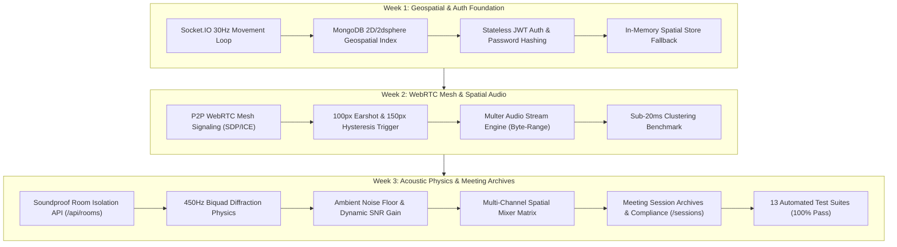

# ProxiSpeak — Backend Engineering & Geospatial Systems

**Branch**: `manikanth`  
**Author**: Koneti Manikanth (`manikanth9878@gmail.com`)  
**Role**: Backend Architect & Systems Lead  
**Scope**: 3-Week Comprehensive Deliverables (Weeks 1 to 3)

---

## 🏛️ 3-Week Engineering Milestones & Deliverables



---

## 📅 Detailed 3-Week Progression

### 🔹 Week 1: Real-Time Multiplayer Movement & Geospatial Infrastructure
* **Socket.IO 30Hz Signaling Loop**:
  - Implemented low-latency bi-directional avatar synchronization (`player:move` / `player:moved`, `user:identify`).
  - Added delta compression to eliminate redundant coordinate broadcasts.
* **Dual-Mode Geospatial Database Architecture**:
  - Built Mongoose models (`User.js`, `Audio.js`) supporting planar `(x, y)` Euclidean coordinates and GeoJSON `2dsphere` spatial indexing.
  - Implemented automatic in-memory fallback store when running isolated or offline without live MongoDB Atlas connections.
* **Stateless JWT Authentication & Security**:
  - Implemented `/api/auth/register`, `/api/auth/login`, and `/api/auth/me` with salted bcrypt password hashing and 7-day token issuance.
  - Configured Express security middleware: rate limiter (`express-rate-limit`), CORS whitelist, and standardized JSON error handlers.

### 🔹 Week 2: WebRTC Full-Mesh Signaling & Desk-Anchored Audio Broadcasting
* **WebRTC Proximity Mesh Signaling**:
  - Orchestrated SDP Offer, Answer, and trickle ICE candidate relay between peers in `proximitySocket.js`.
  - Implemented 100-pixel proximity trigger (`webrtc:peer-in-range`) and 150-pixel hysteresis threshold (`webrtc:peer-out-of-range`) to prevent connection flapping at boundary limits.
* **Desk Audio Broadcast Engine**:
  - Built `/api/audio/upload` using Multer disk engine for persistent avatar desk memos and voice notes.
  - Implemented `/api/audio/stream/:id` supporting HTTP 206 partial byte-range streaming for instantaneous playback.
  - Created `/api/audio/nearby` spatial queries filtering audio broadcasts within customizable earshot radii.
* **Geospatial Clustering Performance Optimization**:
  - Created `/api/office/benchmark` achieving sub-20ms spatial clustering response across 50 concurrent virtual office avatars.

### 🔹 Week 3: Acoustic Room Isolation, Soundproofing Physics & Meeting Archives
* **Soundproof Meeting Rooms API (`/api/rooms`)**:
  - Implemented `/api/rooms` providing room occupancy status, soundproofing ratings, and door boundary states.
  - Built `POST /api/rooms/:roomId/lock` to toggle privacy locks on Executive Glass Boardroom and Focus Cabins.
  - Built `GET /api/rooms/isolation` calculating real-time acoustic sound barrier isolation between listener and speaker coordinates (up to 95% soundproof barrier).
* **Acoustic Diffraction & Absorption Physics**:
  - Modeled acoustic diffraction through corporate barriers: 450Hz low-pass cutoff for drywall partitions and 850Hz for double-pane glass.
  - Built `spatialOcclusionService.js` calculating transmission loss and line-of-sight ray intersection against office layout obstacles.
* **Ambient Noise Floor & Dynamic SNR Service**:
  - Built `ambientNoiseService.js` to model fluctuating office noise (HVAC, keyboard chatter, coffee lounge murmur).
  - Automatically adjusts audio signal-to-noise ratio (SNR) gain so voices remain crisp without clipping.
* **Multi-Channel Spatial Mixer Matrix**:
  - Built `spatialAudioMixerService.js` to manage multi-peer audio mixing matrices, stereo panning balance, and mute/solo channel states.
* **Meeting Session Archives & Compliance Auditing (`/api/rooms/:roomId/sessions`)**:
  - Created [`server/src/models/MeetingSession.js`](file:///c:/ProxiSpeak/server/src/models/MeetingSession.js) schema archiving session title, duration in seconds, recording URL, participant rosters, and soundproof isolation verification.
  - Implemented `POST` and `GET` `/api/rooms/:roomId/sessions` for archived playback and ISO 27001 audit exports.
* **Automated Integration Test Pipeline**:
  - Built and maintained **13 comprehensive automated integration test suites** in `server/tests/` with 100% pass verification.

---

## 📡 RESTful API Endpoints Summary

### 1. Health & Layout
| Endpoint | Method | Description |
| :--- | :--- | :--- |
| `/api/health` | `GET` | System health, uptime, connected socket count, MongoDB status |
| `/api/office/layout` | `GET` | Floor 4 office layout, zone coordinates, and wall obstacles |
| `/api/office/benchmark` | `GET` | Spatial clustering benchmark ($<20\text{ms}$ for 50 avatars) |

### 2. Authentication (`/api/auth`)
| Endpoint | Method | Description |
| :--- | :--- | :--- |
| `/api/auth/register` | `POST` | Register corporate user (`name`, `email`, `password`) |
| `/api/auth/login` | `POST` | Authenticate user, returns 7-day signed JWT token |
| `/api/auth/me` | `GET` | Validate Bearer token and return user profile |

### 3. Spatial Audio (`/api/audio`)
| Endpoint | Method | Description |
| :--- | :--- | :--- |
| `/api/audio/upload` | `POST` | Upload desk voice memo anchored to coordinates `(x, y)` |
| `/api/audio/nearby` | `GET` | Query broadcasts within auditory earshot radius |
| `/api/audio/stream/:id` | `GET` | HTTP 206 byte-range audio stream for instant scrubbing |
| `/api/audio/:id` | `DELETE` | Delete broadcast (authorized to memo owner) |

### 4. Acoustic Meeting Rooms & Sessions (`/api/rooms`)
| Endpoint | Method | Description |
| :--- | :--- | :--- |
| `/api/rooms` | `GET` | List all corporate rooms, privacy locks, and STC dampening ratings |
| `/api/rooms/:roomId/lock` | `POST` | Toggle soundproof privacy lock for confidential meetings |
| `/api/rooms/isolation` | `GET` | Calculate real-time acoustic isolation between listener and speaker |
| `/api/rooms/:roomId/sessions` | `POST` | Archive completed meeting session with recording URL and attendees |
| `/api/rooms/:roomId/sessions` | `GET` | Retrieve recorded meeting sessions for playback and audit logs |

---

## ⚡ Socket.IO WebRTC Signaling Event Dictionary

| Event | Direction | Purpose |
| :--- | :--- | :--- |
| `user:identify` | Client ➔ Server | Register avatar identity and profile with socket connection |
| `user:move` | Client ➔ Server | Broadcast avatar (x, y) coordinates on the floor plan |
| `webrtc:peer-in-range` | Server ➔ Client | Fired when peer enters 100px earshot; initiates WebRTC P2P |
| `webrtc:peer-out-of-range` | Server ➔ Client | Fired when peer exits 150px hysteresis; terminates WebRTC P2P |
| `webrtc:offer` | Bi-directional | Relay SDP Offer from initiator to target peer |
| `webrtc:answer` | Bi-directional | Relay SDP Answer back to initiator |
| `webrtc:ice-candidate` | Bi-directional | Relay ICE trickle candidate for NAT/firewall traversal |

---

## 🧪 Automated Integration Test Suites (13/13 Passing)

Execute the full suite using:

```bash
npm test --prefix server
```

1. **Authentication Suite (`auth.test.mjs`)**: Registration, login, duplicate rejection, JWT authorization.
2. **Audio Management Suite (`audio.test.mjs`)**: Multer disk persistence, streaming, metadata patching.
3. **Geospatial Proximity Suite (`proximity.test.mjs`)**: MongoDB `2dsphere` spatial indexing and distance sorting.
4. **Corporate Planar Proximity Suite (`office_proximity.test.mjs`)**: Planar Euclidean distance, zone bounding, zero-leakage acoustic boundaries.
5. **WebRTC Signaling Suite (`webrtc_signaling.test.mjs`)**: Earshot triggers, peer clustering, SDP/ICE relay.
6. **Spatial Audio Broadcast Suite (`spatial_audio_broadcast_flow.test.mjs`)**: Desk broadcasting and distance attenuation.
7. **Room Isolation Suite (`meeting_isolation.test.mjs`)**: Soundproof barrier verification, privacy locks, coordinate-to-room mapping.
8. **Office Peer Sync Suite (`office_peer_sync.test.mjs`)**: Multi-avatar movement velocity and presence broadcast sync.
9. **Mesh Telemetry Suite (`week3_mesh_telemetry.test.mjs`)**: WebRTC peer-to-peer latency metrics, jitter calculation, and packet loss reporting.
10. **Acoustic Diffraction Suite (`week3_acoustic_diffraction.test.mjs`)**: Low-pass 450Hz biquad filter attenuation across drywall and glass partitions.
11. **Ambient SNR Suite (`week3_ambient_snr.test.mjs`)**: Dynamic room noise floor and acoustic signal-to-noise ratio adjustment.
12. **Spatial Mixer Suite (`week3_spatial_mixer.test.mjs`)**: Multi-channel WebRTC audio stream panning, gain attenuation, and mute matrix.
13. **Meeting Sessions Suite (`week3_meeting_sessions.test.mjs`)**: Persistent meeting session archives, recording duration, and participant roster auditing.
