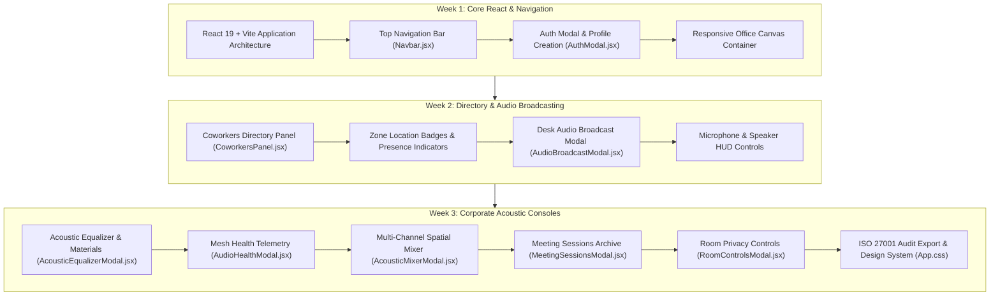

# ProxiSpeak — Frontend UI/UX & React Systems

**Branch**: `harshitha` (mirrored on `harshita`)  
**Author**: Harshitha Rao (`20harshirao18@gmail.com`)  
**Role**: Frontend UI/UX & React Engineer  
**Scope**: 3-Week Comprehensive Deliverables (Weeks 1 to 3)

---

## 🎨 3-Week Engineering Milestones & Deliverables



---

## 📅 Detailed 3-Week Progression

### 🔹 Week 1: Core React Infrastructure, Responsive Layout & Authentication
* **React 19 + Vite Application Shell (`App.jsx`, `App.css`)**:
  - Built the centralized state and viewport management for the virtual office.
  - Implemented dark-mode corporate design language with CSS custom properties (`--bg-main`, `--card-bg`, `--primary-indigo`).
* **Top Navigation Bar (`Navbar.jsx`)**:
  - Rendered brand identity, live WebSocket connection indicator, online employee count pill, and quick-action menu.
* **Authentication & Profile Modal (`AuthModal.jsx`)**:
  - Built dual-mode Login and Registration forms with form validation.
  - Integrated avatar color selectors and stored signed JWT tokens in `localStorage`.

### 🔹 Week 2: Coworkers Directory, Desk Audio Broadcasts & Audio HUD
* **Coworkers Directory Panel (`CoworkersPanel.jsx`)**:
  - Slide-out drawer displaying all active colleagues currently on Floor 4.
  - Categorized peers by office zone: Executive Boardroom, Dev Pod Alpha, Dev Pod Beta, Focus Cabins, and Reception.
  - Displays dynamic distance metrics and peer voice activity indicators.
* **Desk Audio Broadcast Modal (`AudioBroadcastModal.jsx`)**:
  - Modal allowing users to record microphone voice memos or upload `.mp3`/`.wav` audio files.
  - Anchors broadcasts to avatar desk coordinates `(x, y)` and sets customizable earshot broadcast radii (e.g., 50px to 300px).
* **Audio Status HUD Bar**:
  - Bottom controls for microphone mute/unmute, deafen/listen toggles, and real-time WebRTC audio state toast notifications.

### 🔹 Week 3: Corporate Control Consoles, Acoustic Equalizer & Meeting Archives
* **Acoustic Equalizer & Materials Modal (`AcousticEqualizerModal.jsx`)**:
  - 3-band parametric equalizer controls: Low Shelf ($<250\text{Hz}$), Mid Peaking ($1\text{kHz}$), and High Shelf ($>4\text{kHz}$).
  - Physical wall absorption coefficient viewer: inspects NRC ratings for drywall ($\alpha = 0.05$), acoustic foam ($\alpha = 0.85$), and double-pane glass ($\alpha = 0.18$).
* **Audio Mesh Health Telemetry Modal (`AudioHealthModal.jsx`)**:
  - Live diagnostics dashboard tracking WebRTC peer-to-peer round-trip time (RTT), jitter buffer delay, audio packet loss percentage, and spatial clustering latency.
* **Multi-Channel Acoustic Spatial Mixer (`AcousticMixerModal.jsx`)**:
  - Professional mixing console featuring individual channel strips for every nearby colleague.
  - Real-time peer volume faders ($0\%$ to $150\%$), stereo pan balance sliders ($-1.0$ Left to $+1.0$ Right), polar directivity selectors (Cardioid, Supercardioid, Omni, Figure-8), and channel Solo/Mute toggles.
* **Recorded Meeting Sessions Archive Modal (`MeetingSessionsModal.jsx`)**:
  - Archive console for browsing confidential meeting sessions recorded in private rooms.
  - Features category filters ("All", "Soundproof Locked", "Boardroom", "Focus Pods") and search query filtering.
  - Inline simulated Web Audio playback scrubber and `.webm` audio file download buttons.
  - Displays participant attendee chips with avatar tags.
  - One-click JSON export for ISO 27001 corporate compliance audit logs.
* **Room Soundproofing HUD (`RoomControlsModal.jsx`)**:
  - Soundproof privacy lock toggle for Executive Glass Boardroom and Focus Cabins.
  - Room occupancy monitoring and acoustic dampening mode selectors.

---

## 🗂️ Component Architecture & Code Structure

```
client/src/
├── components/
│   ├── AcousticAnalyticsModal.jsx   # Office ambient noise & SPL chart metrics
│   ├── AcousticEqualizerModal.jsx   # 3-band EQ & wall absorption materials inspector
│   ├── AcousticMixerModal.jsx       # Multi-channel peer strip console (faders, pan, polar)
│   ├── AudioBroadcastModal.jsx      # Voice memo recorder & desk-anchored upload modal
│   ├── AudioHealthModal.jsx         # WebRTC mesh telemetry (RTT, jitter, packet loss)
│   ├── AuthModal.jsx                # Corporate JWT authentication & avatar customization
│   ├── CoworkersPanel.jsx           # Active employee directory & zone location badges
│   ├── MeetingSessionsModal.jsx     # Recorded meeting archive, playback & audit export
│   ├── Navbar.jsx                   # Top brand navigation bar & live user counter
│   ├── OfficeCanvas.jsx             # Canvas viewport mount & keyboard event listener
│   ├── RoomControlsModal.jsx        # Room privacy locks & soundproofing dampening HUD
│   └── Sidebar.jsx                  # Collapsible navigation drawer
├── App.jsx                          # Main state orchestration & modal triggers
└── App.css                          # Complete design system & component styles (11 Sections)
```

---

## 📚 Technical Documentation (client/docs/)

- [`WEEK3_MEETING_SESSIONS_UI.md`](file:///c:/ProxiSpeak/client/docs/WEEK3_MEETING_SESSIONS_UI.md): Meeting room sessions archive modal and audit log specification.
- [`WEEK3_ROOM_MIXER_UI.md`](file:///c:/ProxiSpeak/client/docs/WEEK3_ROOM_MIXER_UI.md): Multi-channel spatial mixer console layout and UX guide.
- [`WEEK3_EQUALIZER_AND_MATERIALS_UI.md`](file:///c:/ProxiSpeak/client/docs/WEEK3_EQUALIZER_AND_MATERIALS_UI.md): 3-band parametric EQ and partition absorption materials guide.
- [`WEEK3_ACOUSTIC_ANALYTICS_UI.md`](file:///c:/ProxiSpeak/client/docs/WEEK3_ACOUSTIC_ANALYTICS_UI.md): Acoustic telemetry and ambient noise HUD guide.
- [`WEEK3_UI_SPECIFICATION.md`](file:///c:/ProxiSpeak/client/docs/WEEK3_UI_SPECIFICATION.md): Comprehensive UI specification and style token directory.
