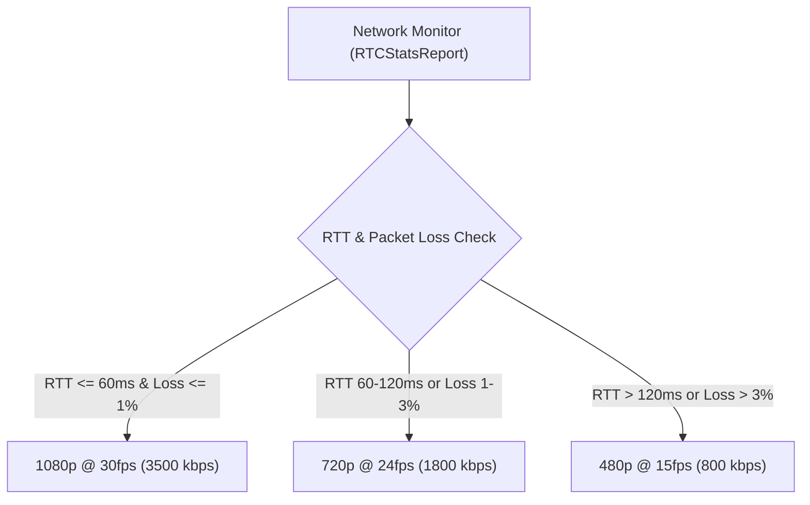

# ProxiSpeak Client — Week 4 WebRTC Adaptive Bandwidth & Bitrate Ladder Specification

**Author**: Leela Sai Likhitha Yekollu <sailikhitha.yekollu@gmail.com>  
**Role**: Canvas Spatial DSP & Audio Engineer  
**Branch**: `likhitha` (mirrored on `likhita`)  

---

## 📈 Adaptive Bitrate (ABR) Ladder

To prevent screen-share video stuttering or audio packet dropouts during enterprise meetings, `adaptiveBandwidthManager.js` dynamically steps through resolution tiers based on real-time WebRTC receiver telemetry.

### Telemetry Threshold Matrix

| Tier | Resolution | Target FPS | Max Bitrate | Condition Required |
| :--- | :--- | :--- | :--- | :--- |
| **1080p** | $1920 \times 1080$ | 30 FPS | $3500\text{ kbps}$ | $\text{RTT} \le 60\text{ms}$ and $\text{Loss} \le 1.0\%$ |
| **720p** | $1280 \times 720$ | 24 FPS | $1800\text{ kbps}$ | $\text{RTT} \in (60, 120]\text{ms}$ or $\text{Loss} \in (1.0\%, 3.0\%]$ |
| **480p** | $854 \times 480$ | 15 FPS | $800\text{ kbps}$ | $\text{RTT} > 120\text{ms}$ or $\text{Loss} > 3.0\%$ |

---

## 🔊 Sidechain Voice Ducking Math
- Formula: $\text{Gain}_{\text{ducked}} = 10^{\frac{-12}{20}} \approx 0.2512$
- Attack Time: $40\text{ ms}$ exponential ramp down when coworker voice activity is triggered.
- Release Time: $350\text{ ms}$ exponential return to normal volume after speech ceases.
