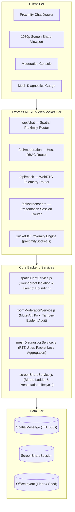

# ProxiSpeak Server — Week 4 Enterprise Collaboration & Telemetry Architecture

**Author**: Koneti Manikanth (`manikanth9878@gmail.com`)  
**Role**: Backend Architect & Systems Lead  
**Branch**: `manikanth`  
**Milestone**: Week 4 Deliverables  

---

## 🏗️ Architecture Overview

Week 4 completes the enterprise collaboration backend suite, integrating proximity chat, WebRTC mesh telemetry diagnostics, host governance access control (RBAC), and 1080p screen-sharing session lifecycle management.

---

## 🚀 Key Modules & Endpoints

### 1. Ephemeral Spatial In-Earshot Chat
- **Model**: `SpatialMessage.js` with 600-second TTL auto-purge index.
- **Service**: `spatialChatService.js` enforces geometric earshot radius ($\le 160\text{px}$) and soundproof room isolation boundaries.
- **REST Endpoints**:
  - `GET /api/chat/stats`: Global chat telemetry and acoustic room isolation status.
  - `GET /api/chat/nearby?x=...&y=...&radius=...`: Retrieves in-earshot messages.
  - `GET /api/chat/zone/:zone`: Retrieves messages within a specific office room.
- **Socket Event**: `chat:send` $\rightarrow$ verifies sender earshot and room soundproofing $\rightarrow$ relays `chat:message` to audible recipients.

### 2. Room Governance & Host Access Control (RBAC)
- **Service**: `roomModerationService.js`.
- **Capabilities**:
  - Room Host claiming and conflict rejection.
  - Mute-All non-host participants with real-time `room:force-mute` socket signaling.
  - Eject/kick attendees with immediate relocation to the Reception Lobby $(x: 220, y: 190)$.
  - Soundproof privacy lock toggling with tamper-evident audit logging.
- **REST Endpoints**:
  - `GET /api/moderation/:roomId/status`: Retrieves current host, lock status, and audit history.
  - `POST /api/moderation/:roomId/claim`: Claims host ownership.
  - `POST /api/moderation/:roomId/mute-all`: Broadcasts mute command to room occupants.
  - `POST /api/moderation/:roomId/kick`: Ejects participant back to Lobby.
  - `POST /api/moderation/:roomId/lock`: Toggles acoustic isolation lock.

### 3. WebRTC Mesh Telemetry & SLA Compliance
- **Service**: `meshDiagnosticsService.js`.
- **Metrics Tracked**: Round-Trip Time (RTT latency), Jitter buffer delay, Packet Loss percentage, Stream Bitrate.
- **SLA Classification**:
  - **EXCELLENT**: $\text{RTT} \le 60\text{ms}, \text{Loss} \le 1.5\%, \text{Jitter} \le 12\text{ms}$.
  - **GOOD**: $\text{RTT} \le 120\text{ms}, \text{Loss} \le 4.0\%, \text{Jitter} \le 25\text{ms}$.
  - **DEGRADED**: $\text{RTT} > 120\text{ms}$ or $\text{Loss} > 4.0\%$ or $\text{Jitter} > 25\text{ms}$.
- **REST Endpoints**:
  - `POST /api/mesh/telemetry`: Records real-time peer-to-peer telemetry sample.
  - `GET /api/mesh/topology`: Returns aggregated mesh health metrics and quality breakdown.
  - `GET /api/mesh/zone/:zone`: Returns zone-specific network latency profiles.

### 4. 1080p Screen Share Presentation Management
- **Model**: `ScreenShareSession.js`.
- **Service**: `screenShareService.js`.
- **Capabilities**:
  - Tracks active presentation sessions in Executive Glass Boardroom and Dev Pods.
  - Multi-tiered adaptive bitrate ladder ($1080\text{p} \rightarrow 720\text{p} \rightarrow 480\text{p}$) on network degradation.
  - Enforces single-presenter exclusivity per room.
- **REST Endpoints**:
  - `POST /api/screenshare/start`: Initiates presentation session.
  - `POST /api/screenshare/:sessionId/stop`: Ends session with duration calculation.
  - `POST /api/screenshare/:sessionId/viewer`: Enrolls viewer.
  - `POST /api/screenshare/:sessionId/adapt`: Records adaptive bitrate adjustment.
  - `GET /api/screenshare/active`: Lists all active office presentations.
  - `GET /api/screenshare/room/:roomId`: Fetches active room presentation status.
